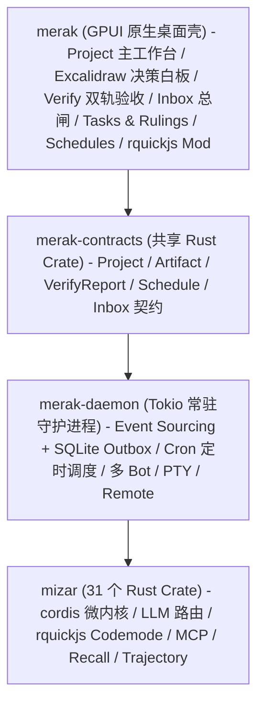

# Merak Core 与 App 能力边界划分

> **定位**：Merak 是基于 Rust 微内核 **Mizar** 与 **GPUI 原生基座（`quiet-md` 演进分支）** 构建的个人 AI 工作台（**Project 导向 · 视觉产物即决策面 · Ryugi 机器自证 vs 人类裁决 · Inbox 总闸 · Tasks & Rulings 账本 · Cron/Watcher 定时巡检**）。总体采用 **「全栈 Rust 同构：Mizar 微内核 + `merak-daemon` 强核 + `merak-contracts` 共享契约 + GPUI 120fps 原生桌面端」** 架构，零 Electron、零 WebView。

---

## 一、总体分层与 5 条架构铁律



### 不可违背的 5 条边界铁律

1. **Execution & Truth in Core（执行权与真理源归 Core）**
   所有真正产生副作用和领域状态变更的能力——Bot 运行、PTY 终端、Git/Worktree、文件系统修改、MCP、定时任务、外部 Issue 同步——全部归 `merak-daemon`。**关掉 GPUI 窗口甚至退出桌面端后，后台 Bot 与任务依然继续跑。**
2. **Tokio 与 GPUI 执行器严格隔离**
   `merak` UI 进程遵循 GPUI 单向响应式循环（`cx.background_executor()`），`merak-daemon` 运行在独立进程（或隔离的后台 Tokio runtime 经有界 channel 桥接），**绝不把阻塞 SQLite 事务、HTTP/SSE 长连接或 `tokio` 锁混入 GPUI 渲染线程**。
3. **Mizar 保持通用，个人工作台业务留在 Merak**
   `mizar` 只做通用 Agent 原语（`cordis` 装配、`AgentLoop`、记忆召回、`rquickjs` 沙箱、轨迹采集）；Inbox、Tasks、Excalidraw 白板、飞书/Markdown 块编辑、GPUI 窗口与分屏布局**绝不反向污染** `mizar`。
4. **UI State vs Domain State 严格分离**
   - **归 App（Client-owned）**：Left Sidebar 开关、Split Pane 拖拽宽度、当前选中 Tab、画布瞬时相机平移缩放与选中手柄、文本编辑光标与未提交草稿、主题 CSS 热重载状态。
   - **归 Core（Server-owned）**：项目与任务主记录、Inbox 审批与提问队列、多 Bot 会话消息流、审批/回执状态、`.excalidraw` / `.md` / `.sqlite` 权威文档内容与版本快照。
5. **同构 Rust + 离屏可控性优先**
   通过共享 `merak-contracts` crate 彻底消灭前后端两套语言的类型漂移；利用 GPUI Patch 0009 `Window::render_offscreen` 提供 **无系统录屏权限的 `shot` 截图与 `devtools` 脚本回放控制面**，让 Agent 能像 Herdr 一样自动改 Mod 并截图自检。

---

## 二、全景能力划分速查矩阵

| 能力域 | Mizar 内核 (Rust) | Merak Daemon (`merak-daemon`) | Shared Contracts (`merak-contracts`) | Merak GPUI App (`src/` + `crates/core`) |
|---|---|---|---|---|
| **LLM 与模型路由** | `mizar-llm-*`、`mizar-llm-router`、重试中间件 | 托管环境配置、`models.json`、Provider 凭据与运行期重载 | 模型快照与能力声明结构体 | 顶部/线程模型切换器、推理状态指示与用量胶囊 |
| **多 Bot 与外部 Agent** | 单会话 `AgentLoop` 与 `AgentSpinePlugin` | 多 Bot 注册表、Always-on 调度、Watcher 批注投递、外部 ACP/CLI | `Bot`、`Ruling`、`ArtifactComment` 回执协议 | **视觉工作导向**：Bot 围绕 Project 的 Canvas 白板与 Verify Report 协作并记录自主 Rulings，退居批注而非纯聊天墙 |
| **Inbox（人类裁决总闸）** | 暴露工具审批 Suspend / Resume 挂起点 | 聚合方案选型、Verify 验收、Gap 豁免、红线审批与批注回流 | `InboxItem`、`InboxKind`、`InboxStatus`、`receipt_settled` | 全局低噪音裁决队列：点击直达右侧 Excalidraw 决策画板或 Verify Report 拍板，拒绝日志泛滥 |
| **Tasks 与项目管理** | 无（不感知项目/看板业务） | Project/Task 状态机、Spec 切片、多仓 Worktree、Tracker 同步 | `Project`、`Task`、`TaskStage`、`Ruling` 账本 | **Project 一等公民**（产物库/任务账本/定时任务/Bots），配合阶段看板与 `fdl_core` SQLite 多维表 |
| **定时任务（Schedules）** | 无 | 常驻 Cron 周期调度、File/Comment Watcher 与关窗后台巡检 | `ScheduledJob`、`ScheduleTriggerKind`、`ScheduleNotifyPolicy`、`ScheduleRun` | 全局定时调度雷达 & 项目子视图：绿灯静默归档，异常 / Gap 自动推 Inbox 并关联 Verify Report |
| **文档 / 白板 / 验收** | 无（只可通过工具调用读写序列化文本） | `.excalidraw`、Verify Report、Markdown/DocxXML 与版本控制 | `Artifact`、`DecisionOption`、`VerifyReportData`、`DecisionPaneTab` | `fdl_core` + `BoardView`（Excalidraw **决策白板 + 选型栏**）+ `Verify` 双轨验收视图 + `Editor` + `TableView` |
| **会话记忆与召回** | `mizar-session-sqlite` (WAL + FTS5)、`mizar-compaction`、`mizar-recall` | 统一 Event Sourcing + Outbox 事务管理，提供 Scoped 增量重放 | 分页查询与游标同步消息协议 | 历史会话回溯面板与全文搜索框（`TextField` 完整 CJK IME 支持） |
| **工具、MCP 与 `rquickjs` Mod** | `mizar-tools-*`、`mizar-mcp`、`mizar-codemode` (`rquickjs 0.14`) | 工作区权限边界、危险命令拦截、MCP 进程池 | Mod 查询与命令调用契约 | **`rquickjs` UI Mod 宿主 + CSS 主题引擎**，通过声明式 GPUI 原语动态扩展 Pane / Inbox Card |
| **控制面与视觉自检** | `mizar-trajectory` 轨迹采集 | 统一任务审计日志与结构化事件回放 | 自动化动作指令（`open_task` / `decide_inbox` / `shot`） | `src/devtools.rs` + GPUI Patch 0009 `Window::render_offscreen` 离屏截图与 CLI 控制面 |

---

## 三、GPUI 基座核心能力继承清单（来自 `quiet-md`）

1. **GPUI-Free 核心引擎（`crates/core`，`fdl_core`）**：
   - `editor::Core`：带随机 Edit Fuzzer 验证的块级编辑与 Undo 状态机；
   - `board::*`：完整移植 Excalidraw 0.18.0 + `rough.js` 4.6.4 + `perfect-freehand`，`.excalidraw` 双向兼容；
   - `table::*`：基于 `rusqlite 0.43` 的 22 字段类型多维表与 100+ 公式函数（10 万行筛选排序 ~22 ms）；
   - `store`（已重定位至 `MERAK_HOME` 与 `~/.local/share/merak/library`，与 Quiet.md 数据完全隔离）。
2. **36 个 Vendored GPUI 补丁（`vendor/zed/` + `tools/vendor-sync/`）**：
   - 解决 CoreText 中文回退错字形、CJK/韩文/RTL 断行、伪斜体、长列表高度估算、微信/文件图片剪贴板、`Window::render_offscreen` 离屏截图与 Windows D3D 设备丢失恢复。
3. **合规与视觉边界**：
   - 严禁携带任何非 MIT 商业图标（已移除 Nucleo 图标与 `Quiet.md` 品牌资产），全站统一使用 ISC Lucide（`assets/editor-icons/`）与 MIT Excalidraw/自绘 SVG（`assets/icons/` + `assets/icons/excalidraw/`）。

---

## 四、推荐仓库目录结构

```text
Merak/
├─ Cargo.toml                     # Workspace root: merak (GPUI bin) + fdl_core + cordis + merak-contracts + merak-core
├─ rust-toolchain.toml            # Pinned Rust toolchain (1.99.0)
├─ docs/
│  └─ core-vs-app-boundaries.md   # 本文档：纯 Rust + GPUI 架构与边界契约
├─ crates/
│  ├─ cordis/                     # cordis: 层次化 Context/Fiber 插件微内核、Effect 清理、DI 与 5 种事件流
│  ├─ core/                       # fdl_core: GPUI-free 文档 / Excalidraw 白板 / SQLite 数据表引擎
│  ├─ merak-contracts/            # 纯 Rust 领域契约（Project / Bot / Task / Inbox）与 Mock Seed
│  └─ merak-core/                 # 基于 Cordis 的 Merak 领域微内核（8 大服务 + Project/Git Fiber 树 + MerakCoreHandle）
├─ src/
│  ├─ main.rs                     # GPUI 入口、字体/快捷键/主题加载与窗口管理
│  ├─ app.rs                      # Merak 原生菜单与工作台全局快捷键 Actions
│  ├─ merak/                      # Merak GPUI 工作台外壳（通过 MerakCoreHandle 桥接 merak-core，绝不直引 cordis/tokio）
│  ├─ editor/                     # 块编辑器 GPUI 视图（复用 fdl_core::editor）
│  ├─ board/                      # Excalidraw + vello_cpu 原生画板视图
│  ├─ table/                      # SQLite 多维数据表 GPUI 视图
│  ├─ input.rs / ui.rs / theme.rs # 完整 CJK IME 单多行输入与统一语义 Theme Tokens
│  └─ devtools.rs                 # 离屏截图 (render_offscreen) 与脚本自动化驱动
├─ vendor/                        # 含 36 个补丁的 Zed GPUI 源码树与 PATCHES.md
├─ tools/vendor-sync/             # 上游 Zed GPUI 补丁同步工具
└─ assets/                        # MIT/OFL 字体 (KaTeX / Xiaolai SC)、Lucide/Excalidraw SVG、CSS 主题
```

---

## 五、分阶段落地路线

- **Phase 0（已完成）：纯 Rust + GPUI 工作台外壳**
  - 完成 Electron 卸载，立足 `quiet-md` GPUI 基座搭好 Inbox + Tasks + Bots + 右侧上下文 Split Pane，并在同一窗口直接嵌入真实的 `Editor`、`BoardView`（Excalidraw）与 `TableView`（SQLite）。
- **Phase 1（当前阶段）：`cordis` + `merak-core` 微内核桥接**
  - 引入 `crates/cordis`（Context/Fiber 生命周期、Effect 逆序清理、DI 与 5 种事件模式）与 `crates/merak-core`（8 大领域服务与按项目热挂载/级联卸载的 Project + Git Fiber 树），通过隔离 `"merak-cordis-rt"` Tokio 运行时的 `MerakCoreHandle` 为 GPUI 提供非阻塞同步/异步桥接，`src/` 全域保持零 `cordis::` / `tokio::` 依赖。
- **Phase 2：`merak-daemon` 常驻化、`rquickjs` 自扩展 Mod 宿主与控制面**
  - 接入 `mizar` 能力并持久化 Event Sourcing / SQLite Outbox，复用 `rquickjs` 向 GPUI 暴露声明式卡片与 Pane 注入原语，搭配 `Window::render_offscreen` 完成自动改 UI + 截图验收闭环。
